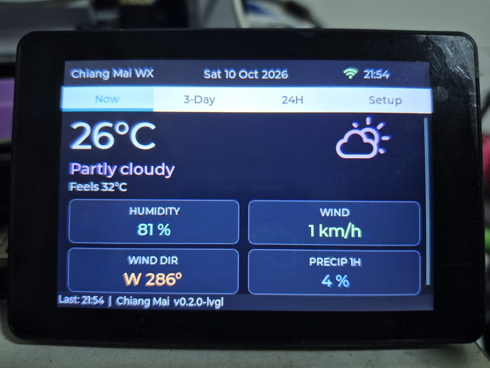
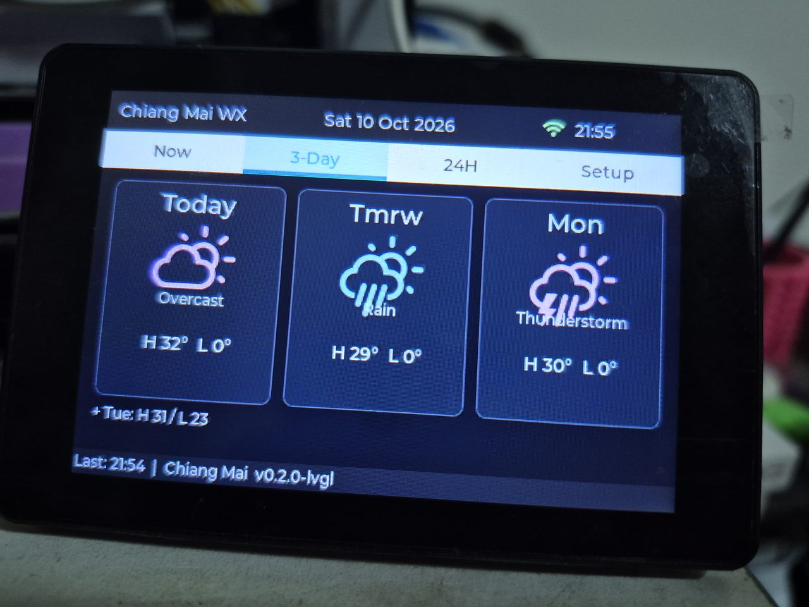
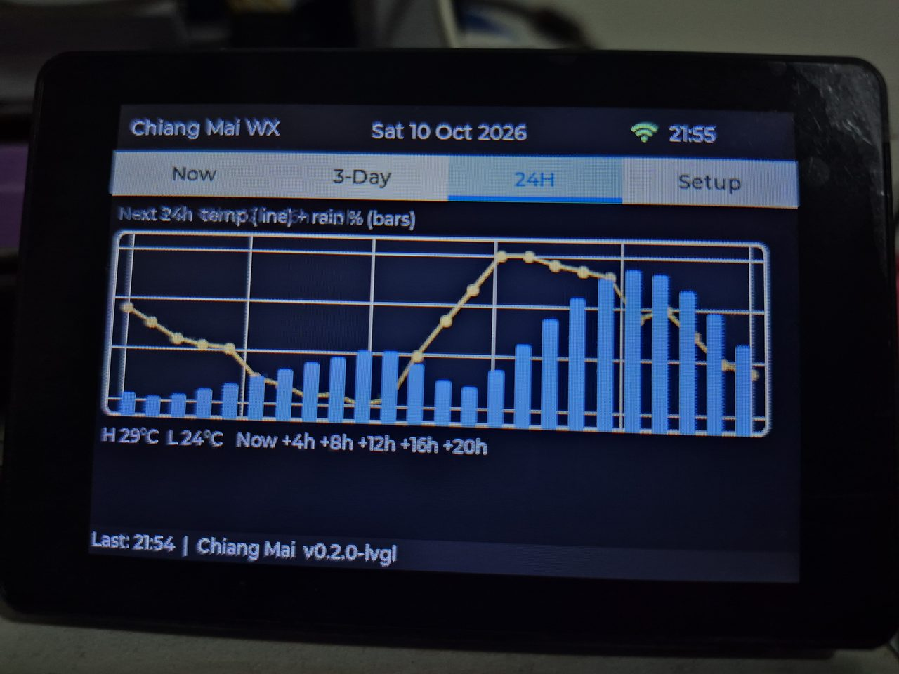
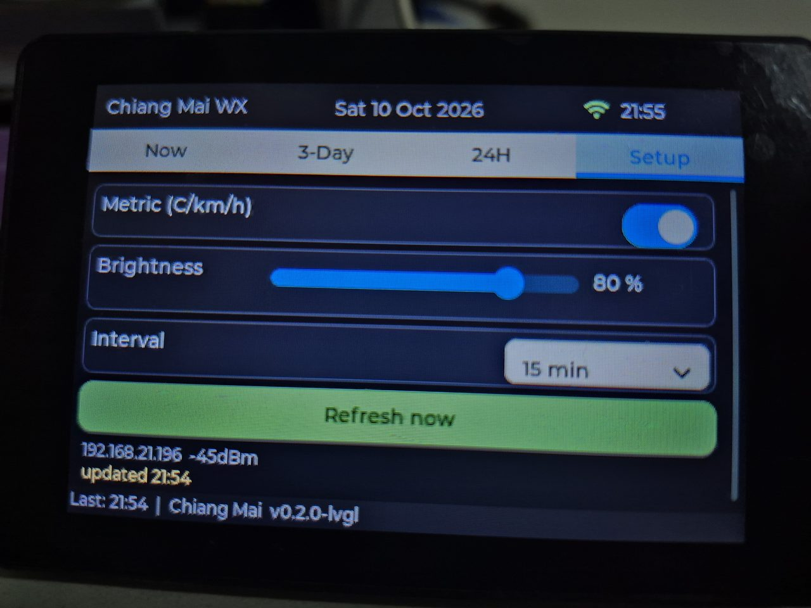

# JC3248W535C Weather Station — LVGL (480x320 landscape)

LVGL v8 weather station for the Guition **JC3248W535C**
(ESP32-S3 N16R8, AXS15231B 320x480 QSPI + capacitive touch),
ported from `../weather_station_1` (Arduino_GFX direct-draw).
Display/touch bring-up follows `../netradio` (proven on this board).

Inspired by [nicholaswilde/cyd-weather-station](https://github.com/nicholaswilde/cyd-weather-station):
same dual-API idea, same Weather Icons font
(`weathericons-regular-webfont.ttf` → `src/weather_icons_*.c`).

## Tabs (swipe left/right)

| Tab | Content |
|-----|---------|
| Now | big temp, Weather-Icons glyph, feels-like, humidity, wind, wind dir, precip |
| 3-Day | daily high/low + icons (Today / Tmrw / weekday) |
| 24H | 24h rolling temp line + precipitation % bars |
| Setup | units C/F, brightness, update interval, theme, refresh now, IP/RSSI |

Header: location + date (center) + WiFi + clock.
Footer: `Last: HH:MM | City + fw version`.

## Screenshots






## Data sources

- `OWM_API_KEY` empty (default) → **Open-Meteo**, no key needed
  (current + 24h hourly + 4-day daily, `timezone=auto`).
- `OWM_API_KEY` set → **OpenWeatherMap** current.
- `DEFAULT_LAT/LON` empty → **IP geolocation** (`ip-api.com`) fallback.

## Hardware

- Display QSPI: CS=45 SCK=47 D0=21 D1=48 D2=40 D3=39, BL=1
- Touch AXS @0x3B: SDA=4 / SCL=8 / INT=3 (no RST)

## Configure

Edit `include/config.h`:

- `WIFI_SSID` / `WIFI_PASS`
- `DEFAULT_LAT` / `DEFAULT_LON` / `DEFAULT_CITY`
- `OWM_API_KEY` (empty = Open-Meteo)
- `TZ_STRING`, `DEFAULT_UPDATE_MINUTES`, `DEFAULT_BRIGHTNESS`

> Fill in your WiFi credentials in `config.h` before building
> (`WIFI_SSID` / `WIFI_PASS`). Do not commit real credentials
> to a public repo.

Runtime settings (units, brightness, interval, theme) persist in NVS.

Themes: Catppuccin Mocha / Macchiato / Frappe / Latte (Setup tab).

## Build / flash

```bash
python3 -m platformio run -e jc3248w535c
python3 -m platformio run -e jc3248w535c -t upload
```

Monitor at 115200 baud — look for `[WiFi]`, `[NTP]`, `[WX]` logs.
